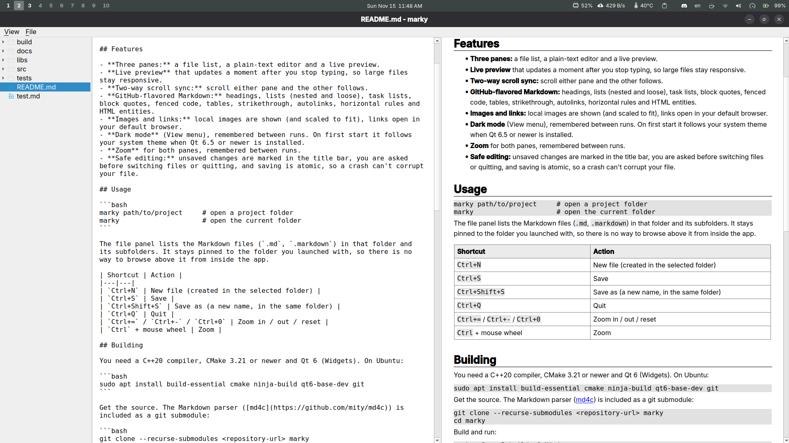

# marky

A native Markdown editor for Linux, written in C++ with Qt 6. No Electron, no embedded browser.

Open a project folder, pick a file from the list, edit it on the left and watch the rendered result on the right.



## Features

- **Three panes:** a file list, a plain-text editor and a live preview.
- **Live preview** that updates a moment after you stop typing, so large files stay responsive.
- **Two-way scroll sync:** scroll either pane and the other follows.
- **GitHub-flavored Markdown:** headings, lists (nested and loose), task lists, block quotes, fenced code, tables, strikethrough, autolinks, horizontal rules and HTML entities.
- **Images and links:** local images are shown (and scaled to fit), links open in your default browser.
- **Dark mode** (View menu), remembered between runs. On first start it follows your system theme when Qt 6.5 or newer is installed.
- **Zoom** for both panes, remembered between runs.
- **Safe editing:** unsaved changes are marked in the title bar, you are asked before switching files or quitting, and saving is atomic, so a crash can't corrupt your file.

## Usage

```bash
marky path/to/project     # open a project folder
marky                     # open the current folder
```

The file panel lists the Markdown files (`.md`, `.markdown`) in that folder and its subfolders. It stays pinned to the folder you launched with, so there is no way to browse above it from inside the app.

| Shortcut | Action |
|---|---|
| `Ctrl+N` | New file (created in the selected folder) |
| `Ctrl+S` | Save |
| `Ctrl+Shift+S` | Save as (a new name, in the same folder) |
| `Ctrl+Q` | Quit |
| `Ctrl+=` / `Ctrl+-` / `Ctrl+0` | Zoom in / out / reset |
| `Ctrl` + mouse wheel | Zoom |

## Building

You need a C++20 compiler, CMake 3.21 or newer and Qt 6 (Widgets). On Ubuntu:

```bash
sudo apt install build-essential cmake ninja-build qt6-base-dev git
```

Get the source. The Markdown parser ([md4c](https://github.com/mity/md4c)) is included as a git submodule:

```bash
git clone --recurse-submodules https://github.com/3brady/marky marky
cd marky
```

Build and run:

```bash
cmake -S . -B build -G Ninja
cmake --build build
./build/marky ~/notes
```

If you cloned without `--recurse-submodules`, run `git submodule update --init` first.

## Tests

The parser has its own test suite. It needs no extra dependencies:

```bash
ctest --test-dir build --output-on-failure
```

Each test feeds Markdown to the parser and compares the resulting tree with the expected one. On a failure it prints the input, the expected tree and the actual tree.

## How it works

```
Markdown text ──md4c──▶ AST ──renderer──▶ QTextDocument ──▶ preview
```

- **`src/markdown/`** is plain C++ with no Qt. It wraps md4c and builds an AST of its own, which also records the source line where each block starts. md4c doesn't report positions, so they are derived from the text pointers it passes to its callbacks. Scroll sync uses these lines.
- **`src/render/`** turns the AST into a `QTextDocument`. It also returns a list of (source line, position in the document) pairs, which is how the two panes are matched up when scrolling.
- **`src/app/`** is the window, menus, file panel, saving and theming.

Keeping the AST between the parser and the renderer means either side can be replaced without touching the other.

## Project layout

```
libs/md4c/       the Markdown parser (git submodule)
src/markdown/    parser wrapper and AST (no Qt)
src/render/      AST -> QTextDocument
src/app/         main window, theme
tests/           parser testsb
docs/            documentation assets
```

## Known limitations

- The editor has no syntax highlighting yet.
- Remote images (`https://...`) are not downloaded; their alt text is shown instead.
- Inline HTML (`<br>`, `<details>`, ...) is shown as plain text.
- Relative links to other Markdown files don't open yet. Only `http`, `https` and `mailto` links are opened.
- Table column alignment and ordered-list start numbers are ignored.
- Changes made to a file by another program while it is open are not detected.
- Developed and tested on Ubuntu.

## Roadmap

- Syntax highlighting in the editor
- Opening relative links in the editor
- Export to HTML and PDF
- An install target with a desktop launcher and icon

## Acknowledgements

Markdown parsing is done by [md4c](https://github.com/mity/md4c) by Martin Mitáš, which is MIT licensed.